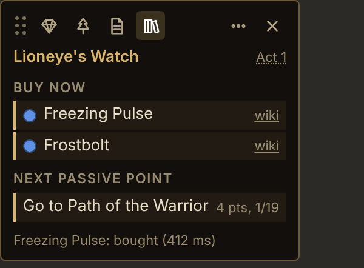
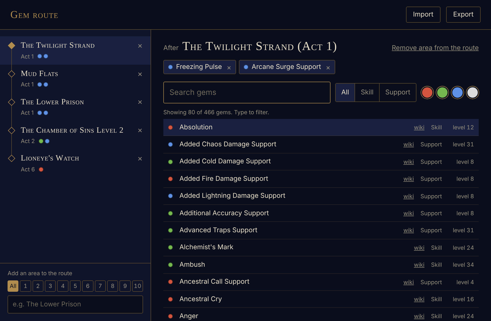
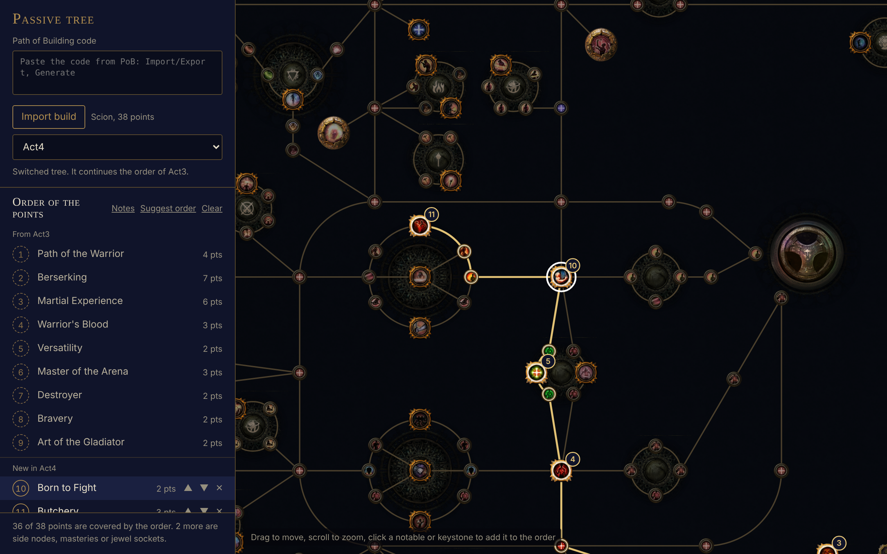
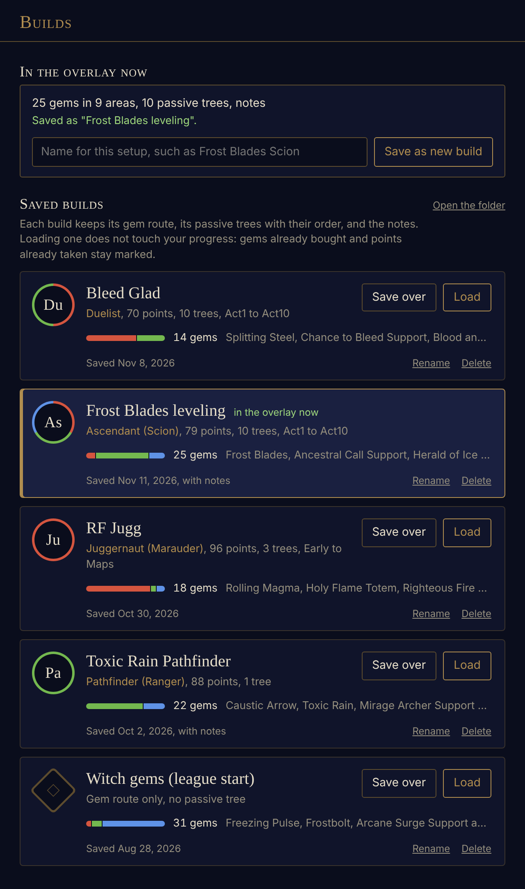

# PoE Gem Overlay

A leveling overlay for **Path of Exile 1**. It sits on top of the game and tells you, as you play:

- which **gems to buy** when you arrive in a town, based on the areas you have been through;
- the **next passive point** of your Path of Building tree, act by act;
- whether a **mercenary** is worth recruiting.

<p>
  
</p>

It works by reading the game log and looking at the screen. It does not read or change the game's memory or
files, and it only sends keys to the game when you press one of its hotkeys.

## Download

Get the latest version from the [Releases](../../releases) page:

- **PoE-Gem-Overlay-Setup-x.y.z.exe** installs it, with a shortcut in the Start menu.
- **PoE-Gem-Overlay-x.y.z-portable.exe** runs without installing.

Windows may show a "Windows protected your PC" notice the first time, because the program is not signed.
Choose **More info**, then **Run anyway**.

**Updates.** When a new version is published, the overlay shows a notice under its bar. With the installed
version, **Update** downloads it and restarts the overlay into it. The portable version can't replace itself, so
**Download** opens the download page.

### Requirements

- Windows 10 or 11
- Path of Exile in **Windowed Fullscreen**, on the primary monitor
- Game client in **English**
- Internet access on the first run (the text reader downloads its English model once, about 5 MB)

### First run

The overlay looks for the game in the usual places (standalone and Steam). If it does not find it, it asks
for the folder where Path of Exile is installed. The only file it reads there is `logs\Client.txt`, which is
how it knows the area you are in. You can change the folder later in the options.

## What it does

### Gems to buy, town by town



Click the **gem** button of the overlay to set up your route:

1. In "Add an area to the route", type the area name and pick it from the list. The act buttons filter the
   list. An area that exists in two acts is listed in both, as two separate areas with their own gems.
2. With the area selected, search for gems and click to add or remove them. Enter adds the highlighted gem.
3. Changes are saved right away and the overlay follows them.

A gem shows up in the overlay once you have entered its area and are standing in a town. **Export** writes
the route to a `.json` file you can share, with its links, and **Import** loads one.

**Buying is noticed by itself.** Inside a town, a Ctrl + left click on a vendor item makes the overlay read
the tooltip title and compare your inventory before and after. The gem is ticked off only when its name is
in the list and a new item entered the inventory, so a purchase that fails (not enough currency, full
inventory) is not ticked. You can also click a gem in the overlay to tick it by hand.

**A chime when you arrive.** Entering a town with gems to buy plays a short sound, so the list is not missed.

**Vendor search (F2).** With a vendor open, press F2 to paste a search for all the pending gems into the
"Highlight Items" field.

### Links, act by act

The **Links** button of the gem route window opens a window to plan which gems you socket together, act by act.

- Pick an act at the top. It shows the gems of that act's areas of the route: active gems on the left, supports
  on the right.
- Click an active gem, then click supports to link them to it, or to take them out. A support can be in several
  links. To put two active gems in one link, tick the box that appears on the other active gems.
- **Add gem** brings in any gem that is not in the route (a quest reward, a gem bought later). It is only for
  the links: you are never reminded to buy it.
- The three small buttons on each gem mark it for that act: **Hold** (box) keeps it in the weapon swap, Set 2;
  **Swap** (arrows) replaces it with another gem you pick, which takes its place in its links (Herald of Ash for
  Purity of Elements); **Drop** (bin) means you throw it away. A marked gem leaves the links of that act. Click
  the button again to remove the mark.
- **Copy links from Act N** starts the act from the links of the act before, along with all its supports, so you
  only adjust what changes. Gems held in Set 2 stay held; dropped and swapped-out gems stay behind. Supports are listed by colour: red, green, blue, then white.

The **sockets** button of the overlay opens a drawer with the final links of an act, drawn like sockets on an
item, and below them the gems to swap, to hold in Set 2 and to drop. It follows the act you are in, can show any other act, and closes by itself when you enter another area.
**Edit** opens the links window.

### The next passive point



Click the **tree** button. The window draws the passive tree with the game art.

1. Paste a Path of Building code and click **Import build**.
2. The notables and keystones of the build are put in a suggested order, from the class start outwards,
   with the number of points each step costs.
3. Drag a point up or down the list to change the order (or select it and use Alt + arrow keys), and click a
   notable or keystone on the tree to add or remove it.

When the build has several trees (one per act, for example), each tree continues the one before. Its list
starts with the points of the previous tree, in the same order, and they are locked there: change them in
the tree they come from and every later tree follows. Below them come the points that are new in this tree,
which you can move or remove. **Suggest order** arranges the new points again and **Clear** removes only
them. The overlay follows the tree selected in this window.

The overlay shows "Go to X" with the next point. Click it when you have taken the point, or **undo last** to
go back one.

**Search when the tree opens (P).** While there is a next point, pressing the passive tree key makes the
overlay check that the tree really opened (it reads the "Skills" banner) and then type the name of the point
into the tree's search field, so the point lights up. It does nothing when the tree is not open, when the
field already shows the right name, or when the field holds a search you typed yourself. This can be turned
off in the options.

**Build notes.** The Notes tab of the PoB build is imported too. The **page** button of the overlay opens
them in a small window that stays on top of the game.

### Builds



The **books** button opens a small library kept on your computer. A build is the whole setup: the gem route,
the passive trees with their order, and the notes.

- Type a name and click **Save as new build** to keep what is in the overlay now.
- **Load** puts a saved build back in the overlay. If the current setup is not saved anywhere, it asks first.
- After changing a loaded build, **Save changes** updates it. **Save over** replaces another saved build.

Loading a build does not touch your progress (gems bought, points taken). Use **Reset progress** when you
start a new character. The builds are plain files (**Open the folder**), so you can copy them to another
computer or send one to a friend.

### Mercenary check (F3)

With a mercenary window open, press F3. The overlay reads the type and the skills, compares them with its
rules and shows the verdict in the middle of the screen: a red cross when it is not worth it, a tick when it is
ok or good, and a golden tick under a rain of gold, with a chime, when it is great.

The rules are in `mercs.json`. To use your own, copy `data/mercs.json` to `%APPDATA%\poe-gem-overlay\mercs.json`
and edit the copy. Each rule looks like this:

```json
{
  "type": "Kineticist",
  "tier": "great",
  "all": ["Kinetic Blast of Clustering", "Greater Kinetic Blast"],
  "any": [],
  "none": [],
  "note": "Why this one is good",
  "sound": "optional-file.mp3"
}
```

- `tier`: `great`, `good`, `check` (good, but check something) or `ok`.
- `all`: skills it must have, all of them. `any`: at least one of these. `none`: none of these.

The same type can have several rules; when more than one passes, the best tier wins. The file is read on
every check, so you can edit it without restarting. To swap the two sounds of the overlay for your own, see
`sounds/README.txt`.

### My regex (F4)

In the options you can save one search of your own, for gear or anything else. F4 types it into the search
field of the open window, such as a vendor or the stash.

## The overlay panel

- **Gem**, **tree**, **page** and **books** open the windows described above.
- **Sockets** opens the links drawer; once you have links, so does the tab on the right edge of the overlay.
- **Three dots** opens a small menu: **Options**, **Window Size** (70% to 180%), **Volume** of the overlay
  sounds (0 turns them off) and **Reset progress**.
- **Minus** minimizes the overlay to a small icon where it was. Click the icon to open it again, or drag it to move
  it. In town, the icon shows how many gems are waiting to be bought.
- **X** closes the program.
- Drag the bar by its dotted handle to move the overlay. Position and size are remembered.
- The act next to the area name can be clicked when the area exists in two acts and the overlay guessed wrong.

## Options

Three dots, then **Options**:

- **Game folder:** where Path of Exile is installed.
- **Hotkeys:** click a key and press the one you want. Esc cancels, and "turn off" removes a hotkey. A key
  that is already taken by another program, or used twice, is flagged on its row.
- **My regex:** the search pasted by F4.

## Is this allowed?

The overlay is built to stay inside what Grinding Gear Games allows for third-party tools:

- it reads only the game log (`Client.txt`) and what is visible on the screen;
- it never reads or changes game memory or game files;
- every input it sends is one action for one key press of yours (F2, F3, F4 or the passive tree key), and
  that action is always "type a text into a search field".

That said, this is an unofficial tool and nobody but GGG can promise anything. Use it at your own risk.

## Where your data is kept

Everything is in `%APPDATA%\poe-gem-overlay` (paste that in the address bar of Windows Explorer):

| File | What it holds |
| --- | --- |
| `state.json` | progress: areas visited, gems bought, points taken |
| `guide.json` | the gem route |
| `treeplan.json` | the passive trees, their order and the notes |
| `builds\` | the saved builds |
| `prefs.json` | the options |
| `overlay.json` | position and size of the overlay |
| `sounds\`, `mercs.json`, `config.json` | optional: your own sounds, mercenary rules and advanced settings |

Deleting the folder puts the program back to a fresh install.

### Advanced settings

None of this is needed. To change something, create `config.json` in that folder (see `config.example.json`):

- `debug`: with `true`, every step is printed to the terminal (when run from source).
- `regexLimit`: character limit of the game's search field (default 250).
- `soundVolumes`: the volume of one sound relative to the slider of the overlay, for example `{ "great": 0.5 }`.
- `toastSeconds`, `toastTop`: how long the centre message stays, and its height as a fraction of the screen.
- `passiveSearchDelay`: milliseconds to wait for the tree to open before checking (default 350).
- `inventory`: leave `null` to use the geometry scaled by screen height. If purchases are not noticed at
  your resolution, set `{ "left": 1271, "top": 588, "cell": 52.67 }` (the 1920x1080 values) adjusted to your screen.

## Known limitations

- Screen positions were measured at 1920x1080 and are scaled by screen height. Other aspect ratios may need
  adjusting.
- Ascendancy, cluster jewel and bloodline nodes are not drawn in the tree.
- Transfigured and Vaal gems are not in the gem list.
- Taking a screen capture causes a very short stutter on some machines. It only happens on a Ctrl + click in
  town and on the hotkeys.

## Development

Requires [Node.js](https://nodejs.org) 20 or newer.

```
npm install
npm start        run the overlay from source
npm test         run the tests (no game or Electron window needed)
npm run dist     build the installer and the portable .exe into dist/
```

If `npm start` fails with "Electron failed to install correctly", run `node node_modules\electron\install.js`
and try again.

To publish a new version, change `version` in `package.json` (for example to `1.1.0`), commit, then push a tag
with the same number:

```
git tag v1.1.0
git push && git push --tags
```

GitHub builds both `.exe` files and attaches them to a new release, with the `latest.yml` file that the
installed overlays read to find the update (`.github/workflows/release.yml`). The repository must be public for
the overlays to see the releases.

### How the code is organised

```
src/
  core/        pure logic: no Electron, no screen, covered by tests
  main/        the Electron main process
    index.js     starts everything, in order
    store.js     what is saved between runs (JSON files in the user data folder)
    session.js   what is only true while running, and the event bus between the parts
    progress.js  pending gems and next passive point, from what is saved
    platform/    screen capture, text reading, key sending, sounds
    features/    one file per thing the overlay does
    windows/     one file per window: creates it and answers what it asks for
  preload/     the narrow bridge each window gets to the main process
  renderer/    the windows themselves: plain HTML, CSS and JavaScript, no build step
data/          gems, campaign areas, towns, mercenary rules, the passive tree
assets/        passive tree art, the icon
test/          node:test suites
```

The rule that keeps it simple: `core` knows nothing about Electron; `main` uses `core`; a window only talks
to `main` through its preload. To follow one feature end to end, start at its file in `src/main/features/`.

| In `src/core/` | What it does |
| --- | --- |
| `guide.js` | the gem route: cleaning, pending gems, which act an area belongs to |
| `links.js` | the links of each act (also loaded by the windows) |
| `build.js`, `treeplan.js` | the passive plan: order of the points, cost of each step, trees that continue each other |
| `pob.js` | decodes a Path of Building code |
| `vision.js` | finds the gem tooltip title on a capture and compares inventory cells |
| `mercs.js` | reads the mercenary window layout and evaluates the rules |
| `regex.js` | builds the vendor search text within the character limit |
| `logwatcher.js`, `gamefolder.js` | follows `Client.txt` and finds the game folder |
| `prefs.js` | which options exist and what values they accept |

## Credits

- Passive tree data and art: Grinding Gear Games, from their
  [skilltree-export](https://github.com/grindinggear/skilltree-export) repository.
- Gem list: the "List of skill gems" and "List of support gems" pages of [poewiki.net](https://www.poewiki.net).
- Text reading: [Tesseract.js](https://github.com/naptha/tesseract.js). Keyboard and mouse listening:
  [uiohook-napi](https://github.com/SnosMe/uiohook-napi). Built with [Electron](https://www.electronjs.org).

## License

[MIT](LICENSE) for the source code. Path of Exile and the passive tree art are property of Grinding Gear
Games. This project is not affiliated with or endorsed by Grinding Gear Games.
